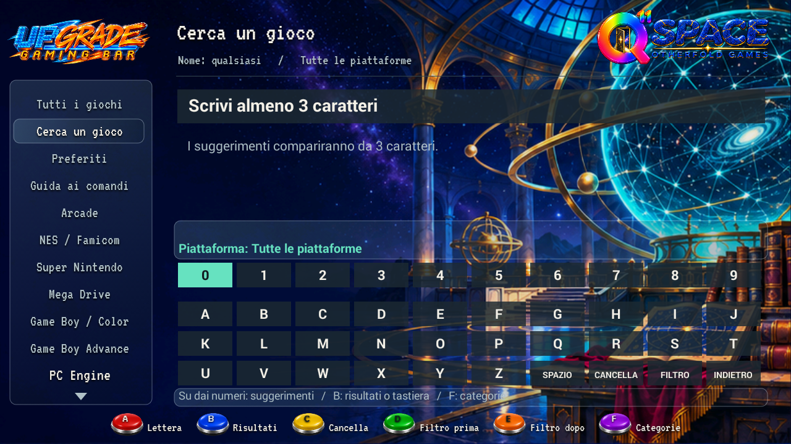
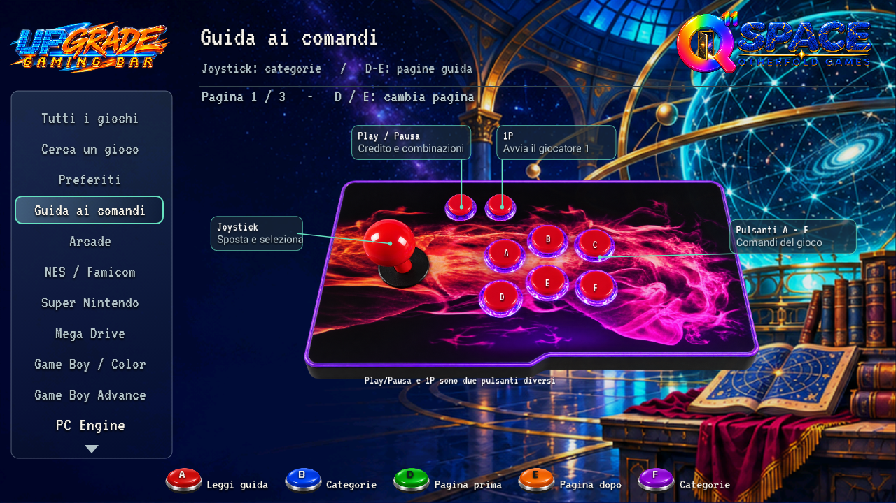

# UpGrade Gaming Bar

**An arcade-control launcher by Q¹¹ Space Otherfold Games.**


[Italiano](README.it.md) · [Build and preview](#build-a-development-preview) · [Contributing](CONTRIBUTING.md) · [Verified limits](docs/VALIDATION.md)

Browse games, search with a joystick-operated keyboard, keep favorites and use an illustrated controls guide. Built for an existing Android/RetroArch installation and tested on one restored arcade console.

**Status: experimental source release, 23 November 2026. Code: [MIT](LICENSE). Artwork/font/brand scopes: [notices](ASSET-LICENSES.md).** This is not a universal Pandora firmware or a ready-to-play ROM collection.

## What is included

- Android launcher source, original project artwork and build instructions.
- Joystick search with suggestions after three characters and optional platform filtering.
- Alphabetical lists, favorites, centered categories, arcade-style button feedback and a controls guide.
- Language selection: Italian and English have 114 initial strings each; Spanish, Portuguese, German, French, Simplified Chinese and Japanese have 12 starter strings each and English fallback.
- Navigation/model/language checks and a workflow prepared to run them on GitHub.

Missing translations are intentional contribution opportunities, not completed localization. CJK rendering and search normalization were checked; the joystick keyboard still enters Latin letters and digits.

## Interface preview

Captured from the isolated development preview with an empty catalog, not the private game collection. The interface shown is Italian; language selection is available in Settings.





## What you must provide

RetroArch, suitable cores, controller configuration and content you are authorized to use. The distributable catalog is empty. Games, BIOS, emulator binaries, original vendor firmware/skins, production signing keys and network credentials are excluded.

The private console has 484 entries in its main views, but that collection is not part of this project. Entry counts do not mean full-game completion testing or distribution permission.

## Verified integration

| Item | Tested installation |
|---|---|
| Model / platform | n200 / Amlogic meson8; printed board revision not verified |
| Android | 4.4.2, API 19, ARMv7 |
| Output | 1280 × 720 |
| Emulator application | Separately installed RetroArch ARM32 1.22.2 |
| Controls | Two-player arcade panel exposed through keyboard/gamepad events |
| Content storage | Tested microSD with a private compatibility mount adapter |

The multilingual launcher is active on the reference device. Native microSD boot, representative game launches and normal exits were checked. Owner tests confirmed physical controls/audio on selected games. These are distinct from automated checks and do not establish support for other boxes sharing Pandora branding.

Three original Q11/UpGrade startup presentations with random alternation and an animated waiting cue were integrated separately on the reference device. The Amlogic last-frame overlay issue was corrected and the owner confirmed menu visibility and joystick operation. A roughly two-second black transition remains. The board-specific root/startup integration is documented, not packaged as a universal installer; see [startup notes](docs/STARTUP.md).

Wi-Fi passed transfer, brief idle, reconnection and cold-boot tests without Ethernet, but earlier authentication failures remain part of the history. Long-term stability and the venue network are not guaranteed. See [hardware](docs/HARDWARE.md) and [validation](docs/VALIDATION.md).

## Build a development preview

Requires JDK 17, Python 3, PowerShell, Android API 19 `android.jar`, and Android build tools providing aapt, D8, zipalign and apksigner. SDK tools are not bundled.

```powershell
./run-tests.ps1
./build.ps1 -AndroidJar 'C:/Android/sdk/platforms/android-19/android.jar' -BuildTools 'C:/Android/sdk/build-tools/35.0.0' -Preview
```

The preview uses package `com.upgrade.arcade.preview`, has no HOME intent and reads an empty, separate content path. It can coexist with production. The output is development-signed; it cannot update the owner's privately signed installation. No build step uses a production key.

The non-preview development build retains legacy package `com.upgrade.pandora` for integration compatibility. Do not install it over a working launcher as a first experiment. Read [installation assumptions](docs/INSTALLATION.md) before device testing.

## Content integration

Current paths and emulator intent values are device-specific. The production root is `/storage/external_storage/sda1/Pandora-Prototipo/`, with separately installed cores under the RetroArch app's data directory. On the reference device a private adapter maps microSD content to that path; copying this source does not install the adapter or make protected core directories accessible.

See [catalog format](docs/CATALOG.md). Add only your independently prepared, authorized content. Interface translation does not change a game's language. Platform names are text in the public package; third-party logo images are not bundled.

## Help improve it

Start with [contribution instructions](CONTRIBUTING.md) and [small contribution targets](docs/ROADMAP.md). We particularly welcome translation review, exact hardware/input reports, readability improvements and links to original authors' authorized game releases. Do not upload ROMs, BIOS, private backups or credentials.

The project does not claim endorsement by the original console vendor. Q11 and UpGrade identify the publisher and product. Code is MIT; three non-brand artwork files are CC BY 4.0; VT323 retains OFL. Q11/UpGrade brand permission is separate. See [asset notices](ASSET-LICENSES.md), [brand policy](BRAND-POLICY.md) and [component review](docs/LICENSE-REVIEW.md).
